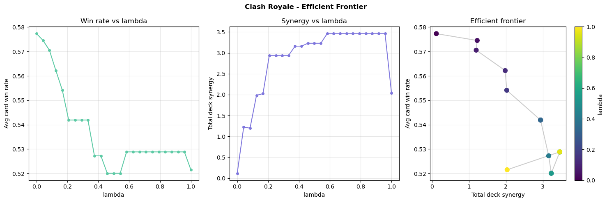
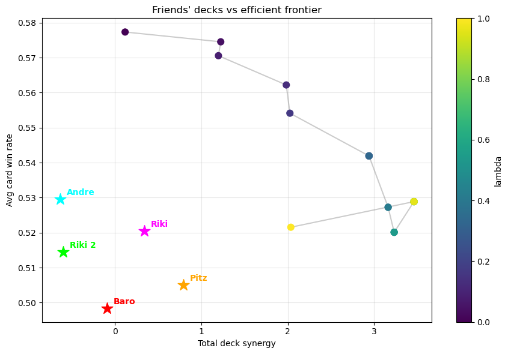

# Clash Royale Deck as a Portfolio

A side project that applies portfolio-optimisation ideas to Clash Royale deck building: cards are treated as assets, and an 8-card deck as a portfolio.

| Portfolio theory | Clash Royale |
|---|---|
| Asset | Card |
| Expected return | Card win rate (μ) |
| Covariance matrix | Pairwise card synergy (S) |
| Budget constraint | Elixir cap (total cost ≤ 32) |
| Risk-aversion parameter | λ, trade-off between win rate and synergy |
| Efficient frontier | Best deck for each λ ∈ [0, 1] |

## How it works

1. **Data collection.** Battle logs are pulled from the official [Clash Royale API](https://developer.clashroyale.com) with a breadth-first crawl: starting from a seed player, the script follows opponents to new players.
2. **Card win rates (μ).** Share of battles won by decks containing each card.
3. **Synergy matrix (S).** For each pair of cards: win rate of decks containing both, minus the average of their individual win rates.
4. **Optimiser.** A greedy algorithm builds an 8-card deck maximising `(1 − λ)·μ + λ·synergy`, subject to the elixir budget.
5. **Efficient frontier.** Repeating the optimisation for 25 values of λ traces the win-rate / synergy frontier; real decks are plotted against it.

## Results

- **Data:** 7,212 battles from 300 players, covering 123 distinct cards.
- **Frontier:** a clear trade-off. At λ = 0 the optimiser picks the highest-win-rate cards (average card win rate **57.7%**, synergy +0.12); at high λ synergy rises to about +3.5 while the average win rate falls to about 52–53%.
- **Optimal deck** (highest win rate among decks with positive synergy, λ = 0): Night Witch, Monk, Goblin Drill, Fire Spirit, Goblin Giant, Skeleton Barrel, Rascals, Hog Rider – average elixir 4.0.
- **Friends' decks** all sit below the frontier (average card win rates of 49.8–53.0%), i.e. they are "inefficient portfolios".





## Robustness choices

- **Small-sample noise:** pairs seen fewer than 10 times get zero synergy, and cards with fewer than 20 games are excluded from the optimiser. Even so, the top synergy pairs rest on only 11–14 co-occurrences, which is why synergy-heavy decks do not beat the pure win-rate deck.
- **Symmetric synergy matrix:** pair counts are filled in both triangles, so a card's synergy does not depend on the order cards are added.

## Run it

```bash
pip install -r requirements.txt
export CR_API_KEY="your_token"   # free key from developer.clashroyale.com, tied to your IP
jupyter notebook clash_royale_portfolio.ipynb
```

Set `SEED_TAG` in the setup cell to your own player tag. The crawl takes about 6 minutes; you can pickle the records to avoid re-crawling.

## Limitations and next steps

- Win rates are not adjusted for player skill or trophy level.
- The greedy optimiser is fast but not guaranteed to find the global optimum.
- Synergy is pairwise only; three-card interactions are ignored.
- Cards missing from the elixir table default to a cost of 4, and card names must match the API exactly (e.g. the API calls "Log" "The Log").
- Next step: shrink synergy estimates toward zero in proportion to sample size (a Bayesian / James–Stein-style correction) instead of a hard threshold.
